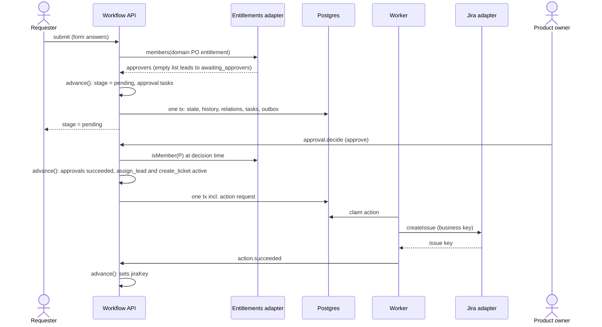
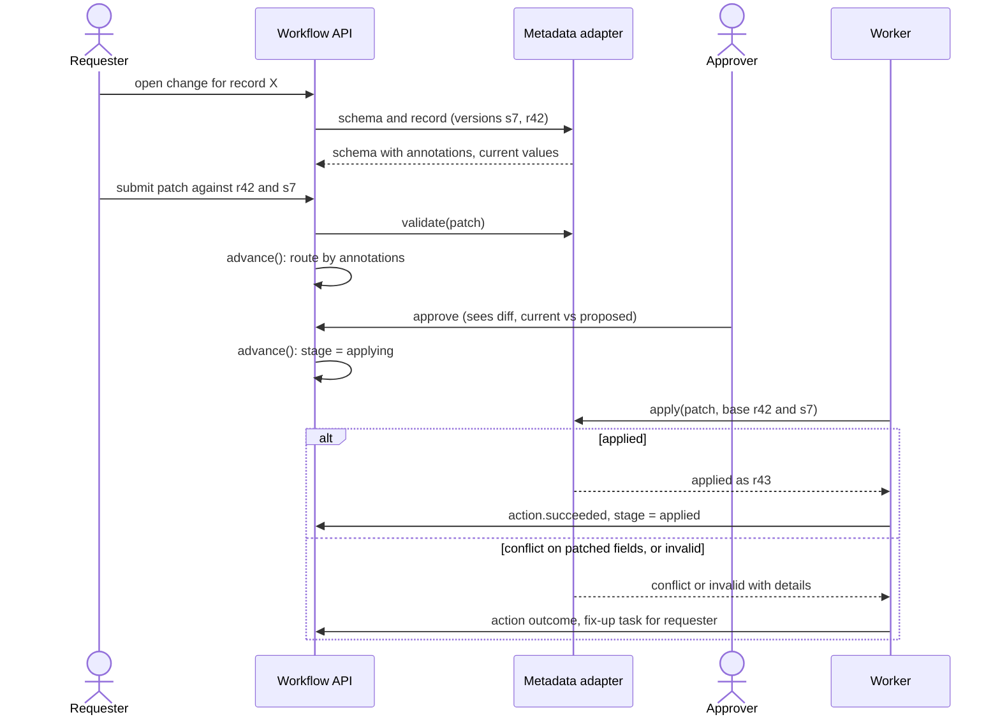

Contents

1. [Overview and what changed](#overview)
2. [Requirements](#requirements)
3. [Design principles](#principles)
4. [Packaging and distribution](#packaging)
5. [L1System context](#context)
6. [L2Containers](#containers)
7. [L3Engine core](#engine)
8. [L3Definition spec v0.2](#spec)
9. [Approvals](#approvals)
10. [Branches, joins, subflows](#composition)
11. [Logic layer and forms](#logic)
12. [Integrations and metadata](#integrations)
13. [Authorization and admin powers](#authz)
14. [Versioning and change policy](#versioning)
15. [Recert: obligations module](#recert)
16. [L4Key flows](#flows)
17. [Data model](#data)
18. [Review findings](#review)
19. [Roadmap and must-fix by phase](#roadmap)
20. [Decisions and open questions](#decisions)

System design · v2.1 · draft for team review

# Workflow Platform Design

A generic workflow engine shared by several independent workflow applications. Our change-request intake becomes the first application on it; architecture review, tech debt initiatives, metadata change requests and metrics recertification follow as configuration plus a small number of bounded extensions.

**Status** v2 draft, after a 14-agent design review **First target** Change-request intake at parity (MVP) **Scope** Engine, UI kit, admin console, integration contracts, obligations module

## Overview and what changed in v2

The architecture from v1 held up under review: every reviewer kept the pure reducer, the transactional outbox, stages with a node graph inside, CEL, the four integration shapes, freeze-by-default, and upstream entities. What failed was the specification on top of it. Reviewers had to invent between 14 and 42 missing constructs each to write real definitions. v2 fills those gaps and records the decisions made since.

The biggest changes:

- **Namespaces.** One engine serves many independent applications, each with its own pages, lists and owners. Shared tables, scoped by a `namespace` column.
- **UI ships as layers** (headless client, UI kit, reference application), not as one product UI.
- **Definitions live in the platform database** and are published through an API and an admin console. YAML or JSON is a file format, not the source of truth.
- **Outcome-aware execution:** every node records a result, joins understand results, and actions report back.
- **Approvals become a declarative policy** with explicit rules for empty approver lists, self-approval and live eligibility.
- **Requirements belong to gates**, which makes migrations a linear, forward-only chain of upgrade steps.
- **A patch type** and compare-and-set apply for change requests against upstream records (platform metadata).
- **Recertification moves to an obligations module** built on the same foundations.
- **Break-glass super-admin** so the dev team never waits on a deployment or an entitlement during an incident.

Added in v2.1:

- **History is the source of truth** (event sourcing). Current state is a rebuildable projection; each event references a content-addressed snapshot of the full instance state.
- **Kernel and composites.** The engine executes a small kernel; approvals, reviews and attestations are versioned composites that expand at publish time.
- **Simpler child model:** await or fire-and-forget, ownership on abandonment, reference-based clean-up, input-based respawn.
- **Prefill** of form fields from upstream data, and the MVP foundations that keep UC5 routing addable later.
- **Scope:** UC5 routing, UC6 metadata updates, UC4 obligations and UC2 interfaces are v2. Expected load is about one request every 10 seconds.

The doc moves through levels of zoom (C4): L1 context, L2 containers, L3 components, L4 flows. Diagram colors are consistent throughout:

- We build it
- Adopted (library or standard infrastructure)
- Existing company system

## Requirements

Use cases the platform must support. Items marked "stated" came from the product owner; "inferred" items were proposed during design and still need confirmation.

| ID | Use case | Stated | Inferred |
| --- | --- | --- | --- |
| UC1 | **Change-request intake** (existing app, MVP) | Multi-page conditional form; submit → pending; approvals by request type and entitlements; an approver assigns an eng lead; lead moves in development → released; reject is terminal. | Notifications, existing reports, drain cutover, comments and attachments. |
| UC2 | **Tech debt initiatives** | Anyone submits; initiative types may differ; parallel sub-workflows; parent branches on sub-workflow outcomes; conditional chaining; spawn now, join later; spawned flows survive a send-back and aren't respawned. | Triage; one definition with variants plus a shared interface. |
| UC3 | **Architecture review** | Lots of back-and-forth; interrupts; send back several stages at once; in-flight reviews may need to follow an updated process. | Revisions with scoped carry-over, clarifications, hold/resume, SLAs, threads, revision diffs. |
| UC4 | **Metrics recertification** | Annual recert; time-based triggers and interrupts; metric inventory as source of truth; notifications. | Rolling or risk-tiered cadence, owner fallback chain, deadline default, bulk certify, evidence. |
| UC5 | **Domain-routed change requests** | Domains a/b/c: PO approval from the domain's entitlement, optional advisory approvals from other domains' POs; Jira ticket with mapped fields; type d auto-approved by a system identity with a fixed Jira PO; UI-configurable; domains sourced upstream. | Decision table with coverage checks; policy tables editable without republish. |
| UC6 | **Metadata change requests** (new) | Change requests that update platform metadata; metadata is polymorphic jsonb; metadata can also be edited outside change management; domain owners may want to change a class's schema. | Schema-generated forms with overlays; patch type; compare-and-set apply; annotation-driven routing. |

Platform requirements: **P1** workflows as a service for other teams · **P2** prefer existing libraries · **P3** UX lives in our app · **P4** company component library · **P5–P7** dynamic labels, dynamic options, cross-field validation · **P8** data flows between forms · **P9** definedness checking · **P10** forms and flows authored together · **P11** no Turing-complete authoring · **P12** engineer-written functions usable from the UI · **P13** integration abstractions · **P14** possibly use the internal form creator.

## Design principles

- **One pure reducer**`advance(def, state, event) → (state, effects, history)`. No I/O, no clock. All data an event needs is fetched first and recorded with it.
- **Stages outside, graph inside**A state machine over stages handles loops and jumps. Each stage iteration runs a small node graph. Destructive moves are stage transitions; non-destructive ones (hold, asides, edits) are not.
- **Every node has a result**succeeded, declined, failed, cancelled, skipped or bypassed. Joins and gates read results, never just "done".
- **Requirements belong to gates**"Required" means "this transition can't happen without it". Data may be incomplete; progress may not.
- **Flat instances, typed links**Children own their lifecycle. The parent either awaits a child's output or fires and forgets; when nothing references an awaited child any more, the parent's ownership policy applies. Links carry generations so stale results are recognized.
- **History is the truth**Append-only history of events with their recorded inputs. Current state is a projection that can be dropped and rebuilt by replaying history through the reducer.
- **Kernel plus composites**The engine runs a small kernel. Admins configure composites (approval, review, attestation) that expand into kernel parts when a definition is published.
- **One shared context, typed**Envelope, payload, node outputs, vars, entities, decisions, constants. A single model of absence. A typed data dictionary comes first; forms are layouts over it.
- **One expression language**CEL in typed slots, each slot with its own expected type and error policy. Extended only by registered, versioned functions.
- **Effects through an outbox**State, history and effects commit together. Effects and events carry stable IDs and generation tags; late results become recorded no-ops.
- **Four integration shapes**Data sources (queries, entities), event sources, actions (with typed outcomes), event sinks. Adapters are extensions, never engine code.
- **Registries, not scripting**Extension happens by registering adapters, functions, widgets and type mappings. End users never write code; node types stay a closed set.
- **Structure pinned, policy optional live**Instances stay on their version by default. Owners can opt into live policy tables or a forward-only upgrade chain.
- **Everything is auditable**Overrides, break-glass, publishes and migrations all go through the engine as events and an append-only audit log. Nothing edits the database directly.

## Packaging and distribution

### What belongs where

| Layer | Contents | Owner |
| --- | --- | --- |
| **Engine core** (generic) | Reducer; stages and nodes; approvals; links and subflows; timers and triggers; CEL and function registry; context, form port and data dictionary; patch type; entity references; decision tables; authorization relations and projection; version chain and edit/bulk edit; outbox and action ledger; integration contracts; saved filters; super-admin. | Workflow platform team |
| **Platform modules** (generic, optional) | Obligations module; type and reference-data registry; schema-driven form generation; Studio (later). | Workflow team, or a shared platform team for the registry |
| **Extensions** (company-specific) | Metadata adapter; domain, entitlement, directory and Jira adapters; widgets for custom types; custom functions (business calendars); annotation vocabulary such as `changeApproval`. | The team that owns each integrated system |

### Kernel and composites

Approvals are not an engine primitive. Following the workflow-patterns literature (control flow, resources, data), the engine executes a small kernel, and common patterns are composites built from it.

| Kernel part | What it is |
| --- | --- |
| Stage machine | Where the instance is; transitions between stages |
| Work item | A unit of work assigned to a principal; ends with an outcome and data |
| Automated step | Calls something external; ends with an outcome |
| Wait | For time, an event, or a condition |
| Composition | Sequence, parallel, branch, join policies, `each` (multi-instance) |
| Subflow | A linked child instance |
| Data and rules | The shared context and CEL |
| Allocation rules | Who may act: relations, eligibility, separation of duties, delegation, escalation |

**Composites** each have safe defaults and their own authoring screen: approval (work items × multi-instance over approvers × join policy × allocation rules × carry-over and audit), review, attestation, data collection, triage, acknowledgement, sign-off chain. Composites are versioned. They expand into kernel parts at publish time, and the definition's lockfile records which versions were used, so a new composite version never affects published definitions or in-flight instances; workflow managers adopt it by republishing. The kernel carries the compatibility promise: semantic versioning, backward compatible within a major version, verified by replaying recorded histories before each release.

### Namespaces: one engine, independent applications

Each workflow application (Change Management, Tech Debt, Architecture Review, Metrics Recert) is a **namespace**. A namespace owns one or more definitions, its own pages, lists, owners, operator views and integration grants. Namespaces don't see each other's data or UI.

- **Storage: pool within a deployment.** Shared tables with a non-null `namespace` column (default `"default"`), every query and index scoped by it, Postgres row-level security as a backstop. One worker fleet, one engine schema to migrate, creating a namespace is a row rather than DDL.
- **Silo across deployments.** Anyone needing hard isolation runs a separate deployment and database. The engine does not build schema-per-namespace machinery.
- **Links stay inside a namespace by default.** A cross-namespace link (for example a tech debt initiative using the security team's review workflow) is allowed only when the child definition declares who may spawn it; the parent shows a status card that links to the other application.

### UI layers

1. **Headless client:** typed API client and state hooks (`useInstance`, `useAvailableActions`, `useTaskList`, `useFormSession`, `useTimeline`, `useLinks`).
2. **UI kit:** components built on the company component library (stage progress, action bar, timeline, task list, approval panel, linked-instance cards, patch diff, form renderer), each overridable through slots and the renderer registry.
3. **Reference application:** list, instance, my-action-items and create pages assembled from the kit. Change Management is built this way and doubles as the reference.

Each application is a route module mounted at its own base path, with a manifest: namespace, name, route, definitions, which definitions appear in its create menu, default list columns. Each application has its own "my action items" list, queried from the engine's task table by namespace. There is no cross-application inbox. Notifications are a downstream integration, not an engine table.

### Definitions are data, published through an API

The platform database is the source of truth for definitions. There is no CLI access to servers, so publishing happens through the API and a small **engine admin console** for the dev team: a JSON editor with schema validation, Validate, Diff, Dry-run and Publish (with a reason), version history and compare. The same console hosts the global exception queue, the audit log and break-glass. Teams that want pull-request review can keep their JSON in a repo and publish from their own pipeline; that's a convention, not the mechanism. The Studio, later, uses the same endpoints.

L1

## System context

Arrowheads show the direction data moves. Platform metadata now covers domains, metrics and modules, so one metadata adapter serves as the domain registry (UC5), the metric inventory (UC4) and the target of metadata change requests (UC6).

The platform owns definitions, instances, tasks and history. It never owns business data that has a home elsewhere: it references records by ID, records the values it used, and writes back through actions.

L2

## Containers

Each namespace is its own application at its own route, built from the shared UI kit; the admin console is the only global surface and is for the dev team. Everything below the UI is shared: one API, one worker fleet, one database scoped by namespace.

L3

## Engine core

Every way into the engine is an event and follows one path. I/O happens only before `advance()` (prefetch, eligibility checks) and after it (one transaction). Results that arrive for an old iteration or generation are recorded and ignored, or trigger a declared clean-up.

### Reducer rules (v2)

- **Node results.** Nodes end as `succeeded`, `declined`, `failed`, `cancelled`, `skipped` or `bypassed` (admin override). Skips carry a reason: not applicable, or upstream declined.
- **Joins.** `join:` policies: `all_succeeded` (default; at least one leg must actually run), `all_finished`, `any_succeeded`, `first_finished`, `at_least(n)`. A join that can no longer be satisfied produces an explicit `unsatisfiable` result instead of hanging.
- **Gates.** Auto transitions fire on conditions over results and data. Requirements (fields, approvals, linked children) are checked at the gate that declares them.
- **Destructive vs non-destructive.** Stage transitions rebuild the next stage's node graph (new iteration). Hold is an overlay that freezes tasks and pauses timers without leaving the stage. Asides (clarification, add reviewer, invite advisor) and edits (reassign the eng lead, extend a deadline) run without a transition.
- **Generations.** Every effect and inbound event carries (stage, iteration, node, link generation). Mismatches become recorded no-ops or declared clean-up actions.
- **Settle bound.** Exceeding the bound puts the instance into an `incident` state for the exception queue. The compiler flags auto-transition cycles.
- **Concurrency.** Per-command preconditions (e.g. "task still open") replace a single global row version, so autosave and comments don't cause spurious conflicts. A losing user gets an explanation, not a 409.

### History is the source of truth

- Every event is appended to `history` with its recorded inputs (the closure of what it read), the definition version, and a reference to a content-addressed snapshot of the full instance state after the event. Identical snapshots are stored once.
- `instances` is a projection written in the same transaction. It exists for lists, filters and permission checks, and can be dropped and rebuilt by replaying history through the reducer.
- Definition versions are immutable, upgrades are `upgrade.apply` events, and live policy values are recorded when read, so replay always knows which version and values applied.
- Audit views show the closure; debug and admin views show the full snapshot. Snapshots pass through the projection rules like everything else.
- Recorded histories double as the engine's regression suite: replay them before each release and compare states.

### Outbox implementation

The outbox guarantees that an effect is committed in the same transaction as the state change. Implement it with a Postgres-backed job queue that supports enqueueing inside the caller's transaction (for example River, Graphile Worker or Oban, depending on the stack), which also provides retries, backoff and scheduled jobs for timers. Temporal remains a possible later host for the pure reducer but would move the source of truth out of Postgres; at the expected load it isn't needed.

### Events (v1 set)

```
instance.start · form.save · transition · task.complete · task.reassign · edit (single or bulk)
approval.decide · approval.invite · approval.delegate · aside.start · hold · resume
action.succeeded · action.failed · action.unknown · linked.changed · vars.resolved
timer.fired (dueAt, firedAt) · signal · admin.move (reason, bypass values) · upgrade.apply
```

L3

## Definition spec v0.2

Illustrative excerpt of the change-request definition with UC5 routing, showing the v2 constructs. Syntax will be finalized in the package spec.

```
namespace: change-management
workflow: change-request
settings:
  changePolicy: { structure: frozen, policy: pinned, drafts: latest }
  visibility:   { participants: sticky, auditors: { confidential: breakglass } }
  reopen: false
  override:     { secondPerson: false, selfOverride: forbid }

envelope:
  title:       { id: f01, type: string }
  requestType: { id: f02, type: enum<requestType> }
  domain:      { id: f03, type: ref<domain> }              # metadata class "domain"
  engLead:     { id: f04, type: user }
  jiraKey:     { id: f05, type: string }

decisions:
  routing:                                               # typed columns, required default
    columns: { requestType: envelope.requestType, domain: envelope.domain.id }
    outputs: { approval: enum[auto, domain_po], jiraPO: user? }
    rows:
      - { requestType: "d",  domain: any,         approval: auto,      jiraPO: constants.typeDProductOwner }
      - { requestType: any,  domain: [a, b, c],   approval: domain_po }
    default: { approval: domain_po }

stages:
  pending:
    nodes:
      approvals:
        type: approval
        skip:          { when: decisions.routing.approval == "auto", as: system:change-requests, reason: "Request type d" }
        require:       { from: entitlement(envelope.domain.poEntitlement), count: 1 }
        advisory:      { from: poEntitlementsOfOtherDomains(envelope.domain), invitedBy: [requester, approver] }
        onNoApprovers: wait                                 # awaiting_approvers + alert; submit still succeeds
        selfApproval:  forbid
        # outputs: result, decidedBy (required approvals only, typed), decisions[], matchedRule
      assign_lead:
        type: task
        after: [approvals]                                  # join: all_succeeded (default)
        assignees: nodes.approvals.decidedBy.orValue([group:cr-leads])
        sets: { envelope.engLead: answers.engLead }
      create_ticket:
        type: action
        after: [approvals]
        action: jira.createIssue
        key: "cr-" + instance.id                             # business key, survives iterations
        input:
          project: envelope.domain.jiraProject
          fields: { productOwner: decisions.routing.jiraPO.orValue(nodes.approvals.decidedBy[0]) }
        sets: { envelope.jiraKey: result.key }
    auto:
      - { to: rejected,    when: nodes.approvals.result == "declined" }
      - { to: development, when: nodes.assign_lead.result == "succeeded" && nodes.create_ticket.result == "succeeded" }
```

Node types: `task`, `approval`, `action`, `branch`, `subflow`, `each`, `wait`. Trigger types: manual, schedule, event (with declared correlation). Stable IDs on stages, nodes and fields from day one.

## Approvals

An approval is a declarative policy: **steps** that run in sequence, each holding **requirements** that run in parallel. Each requirement has a typed approver source (`entitlement()`, `group()`, `managerOf()`, `managerChain(until:)`, an entity attribute, a queue, or CEL), a count (`1`, `all`, `n`, a percentage), a weight (`required`, `advisory`, `veto`), an optional `scope` of fields, and optionally `forEach` over a list.

- **Empty approver list:** the request is submitted and accepted, the approval node moves to `awaiting_approvers`, the requester sees why, the namespace owner is alerted, and the node resumes automatically when approvers appear (membership event, periodic re-check, owner retry, or super-admin assignment). It never auto-approves. The SLA clock pauses.
- **Self-approval** is forbidden by default on every path (direct, delegation, reassign, override).
- **Live eligibility.** Eligibility is checked when someone decides, prefetched and recorded with the event. Membership changes and departures re-resolve open tasks.
- **Outcomes:** approved, declined, changes requested, expired, withdrawn. Late or duplicate clicks are recorded no-ops with a reason ("already approved by X").
- **Decision record:** revision and content hash, definition version, eligibility evidence, on-behalf-of, the routing rule that fired.
- **Scoped carry-over:** each vote carries over only while the fields in its scope are unchanged since the revision it approved.
- **Escalation:** remind, escalate, reassign or expire with a chosen outcome, on business-day timers.

UC3 builds a pull-request-style `review` node on this model (reviewers own sections; only affected approvals are dismissed). UC4 reuses it for attestations.

## Branches, joins and subflows

- **`branch`** chooses exactly one path, requires an `otherwise`, is checked for coverage, and outputs which branch ran. It replaces hand-written mutually exclusive `when:` conditions.
- **`subflow`** starts a child with typed `inputs` and declared `outcomes` and `outputs`. It replaces separate spawn and wait nodes. Parents read the child's declared outcome, never its internal stage names.
- **Await or fire-and-forget.** A child owns its own lifecycle. The parent either awaits its output (a later node joins on it, from any later stage) or doesn't care.
- **Reference-based clean-up** (like Kubernetes owner references). An awaited child is needed while something in the parent's current state references it. When nothing does (send-back, withdrawal, branch not taken), the parent's ownership policy applies: `cancel` or `keep`.
- **Input-based respawn** (like Make or Bazel). A child records its declared inputs. On re-entry, it is reused if its inputs are unchanged and its outcome is still usable, and respawned if the inputs changed. A CEL escape hatch covers exceptions using `child.outcome`, `child.inputs`, `current.inputs`, `child.generation` and `child.age`. This fixes the UC2 livelock where a rejected child instantly re-rejects the parent.
- **`each`** handles dynamic fan-out: items deduplicated by key, a per-item decision grid chooses the leg (inline approval, task, action or subflow), completion thresholds, fail-fast, cancel-the-rest, per-leg retry, and aggregated outputs. Capped (e.g. 500 items); larger populations belong to the obligations module.
- **UC2 initiative types (v2):** one definition with **variants** (a discriminant field with per-variant forms and nodes, narrowed by the compiler) plus a first-class **interface** (shared envelope, status categories, outcomes). A variant can later be promoted to its own definition implementing the interface without breaking reports or triage.

## Logic layer and forms

- **Slot registry.** Every place an expression appears is a typed slot: expected type, available variables, where it runs (client, server, both), and its error policy. Errors in authorization slots deny.
- **One model of absence.** Fields are present or absent; the form port guarantees answers on hidden fields are cleared; `has()` and `orValue()` are generated by builders, rarely typed.
- **Identity types:** `principal` with subtypes `user`, `group`, `system`; membership helpers instead of string comparisons.
- **Dates:** a date type and calendar functions (`addMonths`, `addBusinessDays`); durations only for fixed lengths.
- **Validation rules** carry a check, a message and the fields to highlight. The same compiled CEL runs in the browser and on the server; custom functions ship with paired implementations and conformance tests.
- **Decision tables** are column-based with typed outputs and a required default, so coverage and overlap can be checked. The matched row is recorded in history.
- **Data dictionary first.** Fields have stable IDs, types, relevance and validation; forms are layouts over the dictionary. A server-side commit pipeline (normalize, enforce field modes, clear hidden answers, check option membership, run rules) runs before the reducer.
- **Prefill.** A field can declare `prefill:` from an expression, including entity reads (e.g. `prefill: envelope.domain.docsUrl`). The form shows the current value, editable. MVP.
- **Internal form creator** (deferred) is a layout and authoring source only. Go/no-go: schema export with stable field IDs, machine-readable logic export, a headless render path using the company component library.

## Integrations and metadata

### Contracts

- **Actions report back** with typed outcomes (`succeeded`, `conflict`, `invalid`, `failed`, `unknown`). An action ledger tracks each attempt; `unknown` is reconciled by lookup on a business key. Error classes decide retries.
- **Connections** hold credentials and grants per namespace (e.g. "Jira projects A and B"), rate limits and circuit breakers.
- **Inbound events** are deduplicated and routed to running instances through declared, indexed correlation fields; unmatched events are buffered.
- **Identity map** from company principals to each external system's accounts.
- **Freshness policy per read:** live, cached with TTL, or snapshot; with a timeout budget at submit.

### Metadata change requests (UC6, v2)

Deferred to v2. The MVP must include upstream data as a capability (the entity data-source contract and prefill) so this can be added without structural change.

- **Metadata is the source of truth.** Change management reads current values and class schemas through an entity data source and never keeps a copy.
- **Schema-generated forms** in three layers: default type-to-widget mapping in the engine; annotations owned by metadata (descriptions, groups, ranges, sensitivity); an overlay owned by the workflow (hide, add, help text). No configurable conversion rules.
- **Validity rules live with the data.** Rules such as min ≤ max are CEL in the class schema, enforced by the metadata service on every write.
- **Patch type.** Each field is `unchanged`, `set(value)` or `clear`. Clear is offered only on optional fields, derived from the schema. The engine emits JSON Merge Patch or JSON Patch as the adapter declares. Approvers see a diff.
- **Routing by annotation,** never by field name: e.g. any changed field annotated `changeApproval: domain-owner` adds the domain PO approval, for every class.
- **Apply is a step inside the workflow:** `approved → applying → applied`. Compare-and-set on the record and schema version; conflicts are checked only on the fields in the patch. `conflict` and `invalid` return to the requester as fix-up tasks; infrastructure failures retry, then go to the exception queue.
- **Schema changes** (level 2) use a fixed, hand-designed schema editor because the meta-schema is platform-owned. No recursion beyond two levels.
- **The metadata adapter is an extension**, owned by the platform metadata team, not part of the engine.

## Authorization and admin powers

- **Roles become relations.** Each role is a CEL expression that returns principals; the reducer writes relation rows in the same transaction; group and entitlement membership is checked live. Each relation is sticky or current, per the visibility setting.
- **One projection function.** Every read surface (instance page, timeline, lists, vars, notifications, search, exports) goes through `project(instance, viewer, purpose)`. Vars are server-only by default.
- **Grants at the namespace level:** owner, operator, override, auditor. Definitions can narrow, never widen.
- **Visibility settings:** participants sticky (default) or current; confidential instances; auditors yes, no or breakglass.
- **Routing fields are protected:** who may choose values like request type d can be restricted; reassignment only to eligible principals; `user.*` banned outside authorization slots.

### Admin override (force-move)

One admin may override, with a mandatory reason. Skipped nodes become `bypassed`, and any outputs later steps read must be supplied in the dialog (recorded with `via: override`, never as a real approval). A dry-run preview shows the consequences; participants are notified; the timeline shows an override marker; every override lands in an after-the-fact review queue. A two-person rule is an optional per-workflow setting. Admins can't override their own requests.

### Super-admin break-glass

Standing membership for the dev team, managed by the team itself. Viewing is always on; changing anything requires self-service elevation with a reason or incident ID for a time-boxed window, with no second approver and no deployment. Powers: read everything, change instance state, work the exception queue, manage timers, pause triggers or stop submissions per workflow, apply a version to one instance, and publish definitions or policy through the API. Every action goes through the engine as an `admin.*` event and the append-only audit log, alerts the team channel, and appears in a post-incident review list. Super-admin actions are never recorded as business approvals.

## Versioning and change policy

```
changePolicy:
  structure: frozen          # frozen | upgradable
  upgrade:
    initiatedBy: [definitionOwner, instanceOwner]
    target: latest           # latest | any
    minFrom: 3               # baseline: older versions finish where they are
  policy: pinned             # pinned | live (tables, constants, overlays read at use, recorded)
  drafts: latest
  reopen: false              # reopened instances follow the upgrade policy
```

Three rules keep this small:

1. **Requirements belong to gates.** Upgrades never have to fill required fields. Requirements only apply at gates still ahead of the instance. For a new requirement on a gate already passed, the step declares `grandfather` (default), `fill_before_next_gate`, `fill_and_reapprove` or `reopen`.
2. **A linear, forward-only chain** (Flyway-style). Each version declares one step from the previous version; instances fast-forward by applying steps in order. Published steps are immutable; no rollbacks; a baseline limits chain length. The compiler generates identity steps for compatible changes, so authors only write steps for structural changes or defaults.
3. **An upgrade is a bulk edit that changes the version.** One primitive, `edit(instances, patch, targetVersion?)`, covers single edits, bulk edits by saved filter, and upgrades. Filling in gaps afterwards is ordinary editing by the instance owner.

Saved filters (conditions over state and history, with "closed" as a built-in preset) select which instances an upgrade or bulk edit applies to. Closed instances are immune to live policy because policy values are recorded when used and history renders from those records.

**MVP:** frozen only. Build the foundations now because they are expensive to retrofit: stable IDs, the absence model, requirements on gates, version pinned per instance and on every history entry, effect IDs from stable IDs, dependency pinning, edit as an engine event, drafts on latest.

## Recertification: the obligations module (v2)

Deferred to v2 for further discussion. Working framing: a calendar-like module of **obligations**, one-off or recurring, created manually or from upstream events, whose dates trigger actions; one of those actions may start a workflow.

Recert is thousands of near-identical small reviews over a population on a cadence, so it is modelled as **obligations** (subject S must be reviewed by date D for cycle C) rather than as a parent workflow with thousands of children.

- **Obligation table** unique on (policy, subject, cycle), with status, reviewer, outcome, attestation details and an optional follow-on instance.
- **Policy** authored by the program team in typed screens: population (a metadata class and filter), cadence (rolling, risk-tiered or campaign windows), reviewer chain, attestation outcomes, write-back, reminder ladder with deadline default.
- **A sweeper** opens obligations, advances reminders and applies defaults as set-based, idempotent operations; it catches up after outages. Departures are a single update to the next reviewer in the chain.
- **Follow-ons** (retire, transfer, change review) are ordinary workflows on the engine, linked back to the obligation.
- **Experience:** an owner workbench with evidence columns and bulk certify, weekly digests, a manager view, a program dashboard computed from the table, and auditor exports.

Rule of thumb: the same small review repeated over a population on a schedule is an obligation; anything else is a workflow. The module shares CEL, entities, notifications, authorization and the UI kit, and is reusable for access reviews, data-owner attestations and policy acknowledgements.

L4

## Key flows

### Change request through approval and ticket creation



Eligibility is checked live when the product owner decides and recorded with the event. Jira's result comes back as an `action.succeeded` event; a lost result becomes `action.unknown` and is reconciled by looking up the business key.

### Metadata change request applied with compare-and-set



Approval is not completion: the request is only done when the metadata service has applied the patch. Edits made outside change management to other fields don't conflict.

### A linked child changes and the parent reacts

```mermaid
sequenceDiagram
  participant C as Engine (child)
  participant DB as Postgres
  participant W as Worker
  participant Par as Engine (parent)
  C->>DB: one tx: child outcome declined, outbox linked.changed
  W->>DB: claim outbox row
  W->>Par: deliver linked.changed (link generation 2)
  Par->>Par: advance(): generation matches, join re-evaluated
  Par->>DB: one tx
```

The link already exists in the parent's state when the subflow starts. Parents read the child's declared outcome, and a stale generation becomes a recorded no-op.

## Data model

Every table carries `namespace`. Indexes lead with it; row-level security backs it up.

| Table | Key columns | Notes |
| --- | --- | --- |
| `namespaces` | key, name, route_base, grants, settings | One row per application. |
| `definitions` | namespace, workflow_key, version, package, compiled, lockfile, upgrade_step, status | Immutable per version; published through the API. |
| `instances` | namespace, id, workflow_key, def_version, stage, iteration, revision, hold, state | Projection, rebuildable from history. Envelope fields as real columns for lists and filters. |
| `history` | instance_id, seq, event, resolved_inputs, def_version, snapshot_hash, actor, via, at | Append-only source of truth; timeline, audit and replay. |
| `snapshots` | hash, state | Content-addressed full instance state; identical states stored once. |
| `tasks` | namespace, id, instance_id, node_id, iteration, assignees, status, due_at | Each application's "my action items" query. |
| `relations` | instance_id, relation, principal, sticky | Replaces the participants index; drives visibility and actions. |
| `links` | from_id, to_id, key, generation, lifetime, ownership, respawn | Unique per key scope. |
| `timers`, `schedules` | scope, name, due_at, generation · spec, overlap, misfire, paused | Timers derived from state and reconciled after each step. |
| `outbox`, `action_ledger` | effect_id, kind, payload · attempt, status, business_key | At-least-once delivery; unknown outcomes reconciled. |
| `inbox` | source, event_id, correlation, status | Dedupe and buffering for inbound events. |
| `obligations` | policy, subject, cycle, due_at, status, reviewer, outcome | Obligations module. |
| `saved_filters`, `audit_log` | namespace, name, condition · actor, action, reason, incident | Bulk edit, upgrades, overrides, break-glass. |

## Review findings

Fourteen agents reviewed v1: nine by capability, five by use case. Scores for v1 (1–5; for effort, 5 means cheap):

| Use case | Correctness | Expressiveness | Admin UX | End-user UX | Effort |
| --- | --- | --- | --- | --- | --- |
| UC1 change request | 2 | 3 | 2 | 2 | 2 |
| UC2 tech debt | 3 | 3 | 2 | 2 | 3 |
| UC3 architecture review | 2 | 3 | 2 | 2 | 3 |
| UC4 recert | 2 | 2 | 2 | 1 | 2 |
| UC5 domain routing | 2 | 4 | 2 | 3 | 2 |

Problems found independently by several reviewers, and where v2 addresses them:

1. Outcomes don't flow back (action results, child changes, joins blind to results) → node results, join policies, action outcome events.
2. Approval rules undefined (empty lists, self-approval, frozen eligibility, wrong decider) → approval policy model.
3. Leaving a stage destroys work (hold, clarifications, reassign, extensions) → hold overlay, asides, edits.
4. No stable IDs and late results aren't fenced → stable IDs, generation tags.
5. Idempotency keys scoped wrong (duplicate tickets, transfers, respawn livelock) → business keys, respawn policy, obligations.
6. Types and absence undefined → slot registry, identity and date types, absence model.
7. Authorization has two sources of truth and many leaks → relations, projection, deny rules.
8. Policy changes forced republishes → live policy option.
9. Collaboration basics missing (comments, threads, whose move, digests, bulk) → platform features in the UI kit and notifications integration.

The UC1 reviewer noted that UC1 alone is roughly what Jira Service Management or ServiceNow already provide. The case for building rests on UC2–UC6 and on owning the app and the component library.

## Roadmap and must-fix by phase

| Phase | Scope | Must-fix items it requires |
| --- | --- | --- |
| **MVP** UC1 parity | Engine core, Change Management application from the UI kit, admin console with publish API, entitlements and directory adapters, notifications integration, cutover. | Node results and joins; approval composite (empty list waits, self-approval, live eligibility, typed `decidedBy`); typed principals (user, group, system), absence model, error policy per slot; edits without transition (reassign lead); comments and attachments; relations, projection and visibility settings; stable IDs and versioning foundations; event-sourced history with snapshots; prefetch with outage policy; entity data-source contract and prefill; action nodes with outcome events in the event model; server-side form commit pipeline; override and break-glass; cutover kit (import keeping the original requester, legacy-ID redirects, replay comparison). |
| **v2** UC5 and UC6 | Domain routing, Jira, metadata change requests. | Typed decision tables with coverage; advisory role and invite; auto-approval; action ledger and business keys; connections and grants; metadata adapter; patch type; schema-generated forms; compare-and-set apply; live policy tables. |
| **Then** UC3 | Architecture Review application. | Hold overlay; asides; scoped carry-over; revisions and diffs; threads; whose-move indicator; review node; timer spec and business calendars; upgrade chain if in-flight reviews must follow process updates. |
| **Then** UC2 | Tech Debt application. | Branch and subflow; lifetime vs ownership; respawn policy; linked.changed; variants and interface; cross-namespace links if needed. |
| **Then** UC4 | Metrics Recert. | Obligations module; event correlation to running work; digests and bulk; workbench. |
| **Later** | Studio. | Typed slot editors, decision grid, simulator, publish with upgrade preview. |

## Decisions and open questions

| # | Decision | Status |
| --- | --- | --- |
| D1 | Build the engine on Postgres with a transactional outbox rather than Temporal or Flowable. Outbox implemented with a Postgres job queue that supports transactional enqueue (implementation detail). | Proposed |
| D2 | CEL for all workflow logic, in typed slots with a curated function library. Revisit if it falls short while iterating. | Decided |
| D3 | Definitions live in the platform database and are published through an API and admin console (was: YAML in a repo, compiled in CI). | Decided |
| D4 | One shared, typed instance context; data dictionary first, forms as layouts. | Decided |
| D5 | Children own their lifecycle; parent awaits or fires and forgets; ownership policy on abandonment; reference-based clean-up; input-based respawn with a CEL escape hatch; link generations. | Decided |
| D6 | Data inputs prefetched before `advance()` and recorded with the event, including live eligibility checks. | Decided |
| D7 | Forms: platform owns field meaning; the internal form creator is a layout source if it passes the go/no-go checks. | Deferred |
| D8 | Event bus: internal to the app; exposing events outside it later is an event-sink adapter. | Deferred |
| D9 | Namespaces: pooled shared tables within a deployment; silo only across deployments. | Decided |
| D10 | UI ships as headless client, UI kit and reference application; each namespace has its own pages and action-item list; no cross-application inbox. | Decided |
| D11 | Single-admin override with reason, bypassed nodes, preview, notification and after-the-fact review; two-person rule optional per workflow. | Decided |
| D12 | Empty approver list: submission accepted, approval waits in `awaiting_approvers`, owner alerted. | Decided |
| D13 | Break-glass super-admin with self-service elevation, no deployment or second approver, full audit. | Decided |
| D14 | Visibility as per-workflow settings; default sticky participants, auditors breakglass for confidential. | Decided |
| D15 | Change policy: frozen in MVP; later live policy and a forward-only upgrade chain; requirements belong to gates; upgrade is a bulk edit. | Decided |
| D16 | Metadata change requests: patch type, schema-generated forms with overlays, annotation routing, compare-and-set apply as an action inside the workflow. Metadata adapter is an extension. The MVP must leave room for it. | v2 |
| D17 | Recertification as an obligations (calendar-like) module on shared foundations. | v2 |
| D18 | UC2 initiative types: leaning toward one definition with shared envelope fields and variants; interfaces supported later. | v2 |
| D19 | Kernel plus versioned composites that expand at publish time; approvals are a composite. | Decided |
| D20 | History is the source of truth; the instance table is a rebuildable projection; content-addressed snapshots per event. | Decided |
| D21 | UC5 routing deferred; MVP includes its foundations (typed principals, approval outputs, action outcome events, entity references). | Decided |

### Open questions

- **UC1 parity:** check the legacy app's exact rules against its code later. Parity is a requirement, with intentional exceptions where the existing behavior is poor.
- **Form creator:** research later.
- **Upstream systems:** the metadata team (same platform team) exposes schemas and records and is refactoring; the MVP only needs upstream data as a capability. Primitives, classes and the owner of domain data to be worked out, ideally with codebase access.
- **UC2:** the program team is likely prescriptive, but some initiatives may differ structurally; confirm that variants in one definition are enough.
- **Obligations:** design discussion in v2.
- **Retention:** keep everything.
- **Scale:** roughly one request every 10 seconds, mostly from the tech debt program. Polling workers, no partitioning, a single worker instance are sufficient.